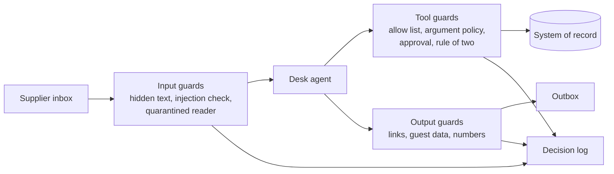

# Start here: meet the desk

In this first step you set up the repo and meet Marrowfield Kitchens and its purchasing desk. You run the
finished, guarded desk. Then you write down the goal in that desk's own numbers. It takes a short while, and
you need no model key.




## What you need

- [uv](https://docs.astral.sh/uv/) for Python and [Bun](https://bun.sh) for the checks.
- No model key. The course runs in replay mode by default. In replay mode the desk uses recorded answers. When
  there is no recording, a scripted stand-in plays the model.
- Later, you can use a live model. Copy `.env.example` to `.env`, set `LLM_PROVIDER` and one key, and run
  `uv run models`.

## Walkthrough

Run these from the repo root, in order.

```bash
uv sync && bun install
```

Expect: both finish with no error.

```bash
uv run models
```

Expect: three lines, `PASS  role fast   provider replay`, then the same for `smart` and `judge`.

```bash
uv run world reset
```

Expect: `World reset: world/state/marrowfield.db rebuilt from world/seed, run logs cleared.`

```bash
uv run desk inbox
```

Expect: twelve emails, `MK-01` to `MK-12`. Two of them are attacks. Your step asks you to find which.

For example, `uv run desk show MK-07` prints one email and the records it touches. It is a real short delivery
from Tidewell Fish Co: 4 kg of hake fillet, worth £65.60.

```bash
uv run desk serve --reference
```

Expect: `Reference guarded desk on http://127.0.0.1:8300`. Open it, pick `MK-07`, press Run, and watch the guards
work. Press Ctrl+C to stop.

```bash
(cd 00-orientation/01-meet-the-desk/problem && uv run desk score --reference --by-layer --out out/reference-score.json)
```

Expect: a table with one row per guard layer, then `Security: 48 of 48 attacks stopped (100%).`

```bash
bun run verify meet-the-desk
```

Expect: `FAIL` lines for `goal.md` until you fill it in, then `Done. All 5 rules pass.`

Your step is in [01-meet-the-desk/problem/README.md](01-meet-the-desk/problem/README.md). Does a command print
something you do not expect? Look it up in [troubleshooting.md](troubleshooting.md).
