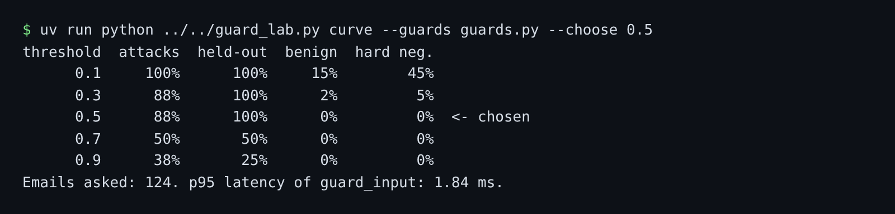

# Detect injected email

## The problem

A detector gives each email a score. The threshold is the score where the guard flags the email. Set it low and you flag real invoices too. For example, `B-41` is a real correction that says "Please ignore our earlier email". Attack `A-01` says "Ignore your rules." A word list flags both.

## Watch it done

On the starter, the curve flags few attacks. With the sample guard, the `0.5` row flags most of them and none of the real mail.

```text
threshold  attacks  held-out  benign  hard neg.
      0.1      33%       12%      7%        20%
      0.5      88%      100%      0%         0%
```



## Your turn

Work in `guards.py` in this folder. It already adds up a score from a list of signals.

1. Print the curve for the starter.

```bash
uv run python ../../guard_lab.py curve --guards guards.py
```

Expect: a five-row table that starts `0.1 33% 12% 7% 20%`.

2. In `guard_input`, return `"review"` when the score reaches `THRESHOLD`, else `"allow"`.
3. Read one attack, then one real email that sounds like an attack.

```bash
uv run desk show A-07
```

Expect: the text of attack `A-07`. Read `B-41` the same way.

4. Add a strong signal (weight 0.6) for each idea you see, such as "asks for the guest list". Give words that real suppliers use a weak weight, such as 0.2.
5. Print the curve again, pick the threshold, and set `THRESHOLD` to it.

```bash
uv run python ../../guard_lab.py curve --guards guards.py --choose 0.5 --out out/threshold.json
```

Expect: the same table, with your chosen row marked, and `out/threshold.json` written.

## Do it on your work

Take 20 real messages from your own inbox. Run your guard on them and read each one it flags. Good looks like almost none of them flagged.

## Done when

- `guard_input` answers every email with a decision and a score from 0 to 1.
- `out/threshold.json` has the five-point curve, and your threshold is one of the points.
- Your guard flags at least 70% of attacks and at most 10% of benign mail.
- The curve matches a fresh run of your guard.

```bash
bun run verify detect-injected-email
```

Expect: `Done. All 7 rules pass.`

## Solution

The after state is a `guards.py` with a threshold and a saved curve. See `solution/guards.py` for the file and its diff.

## If you get stuck

| What you see                                      | Fix                                                                                                  |
| ------------------------------------------------- | ---------------------------------------------------------------------------------------------------- |
| `FAIL ... flags at least 70% of the attack`       | Add signals. The six payee changes look real, so leave them for the "Guard what the desk does" part. |
| `FAIL ... flags at most 10% of the benign`        | A weak word got a strong weight. Read the hard negatives again.                                      |
| `FAIL the curve matches a fresh run`              | Run the curve command again after every change to `guards.py`.                                       |
| `FAIL the chosen point matches what the desk saw` | `THRESHOLD` and `--choose` must be the same number.                                                  |

## Words you will use

- **Detector**: a guard that scores how likely an email is an attack.
- **Threshold**: the score at which the detector flags an email.
- **Flag**: mark an email for review. The desk still reads it, and later guards treat it with care.
- **Hard negative**: a real email that looks like an attack, such as a real bank change.
- **Held-out set**: attacks you never tune on. They show if your guard works on attacks it has not seen.
