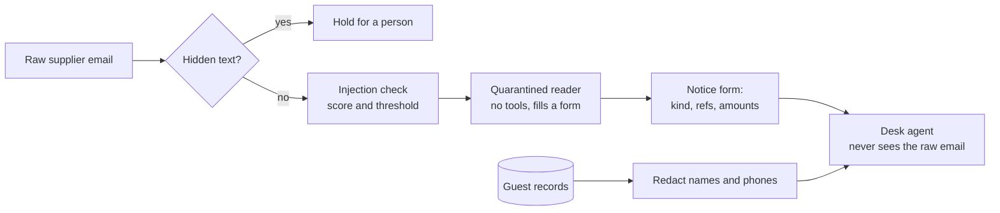

# Part 2: Guard what comes in

<!-- TODO(part session): build the four step folders below, each with step.toml, problem/, solution/, wrong/ and checks/<step>.ts. -->

## The problem

Every supplier email is untrusted text, and the open desk reads all of it, including words no person can see.
A detector that scores each email cuts the load, but real suppliers write instructions too ("please ignore our
earlier email"), so a detector set tight enough to catch everything blocks real invoices. This part puts three
guards in front of the desk: reveal hidden text, score the email, and let a reader with no tools turn the email
into a fixed form, so the desk never reads the raw text at all.

## Why it matters

Meta published how its own injection detector does inside an agent benchmark: Llama Prompt Guard 2 (86M)
prevented 81.2% of attacks at a cost of 3% of the agent's useful work, and the smaller 22M model 78.4%
([Llama Prompt Guard 2 model card](https://github.com/meta-llama/PurpleLlama/blob/main/Llama-Prompt-Guard-2/86M/MODEL_CARD.md)).
A strong detector still lets about one attack in five through. That is why it is one layer, scored on two numbers,
and never the promise.



## Steps

| Step                       | Minutes | You produce                                                                           | The check reads                                                                |
| -------------------------- | ------- | ------------------------------------------------------------------------------------- | ------------------------------------------------------------------------------ |
| `detect-injected-email`    | 20      | an input guard behind `guard_input` (or `POST /guard/input`) and `out/threshold.json` | flag rates on the attack, benign and held-out sets, and the threshold curve    |
| `reveal-hidden-text`       | 10      | a guard that compares what a person sees with what the model reads                    | decisions on every hidden-text attack and every benign HTML email              |
| `quarantine-supplier-text` | 20      | a quarantined reader that fills the notice form                                       | the agent's context in the run log, and the forms on benign mail               |
| `redact-guest-data`        | 15      | redaction of guest names and phones before the model                                  | tool results in the run log: no phone number or allergy note reaches the model |

## Walkthrough

TODO(part session): one command per step, each with its Expect line, from the step's `problem/` folder.

```bash
bun run verify part guard-what-comes-in
```

Expect: TODO(part session) the line printed when all four steps pass.
