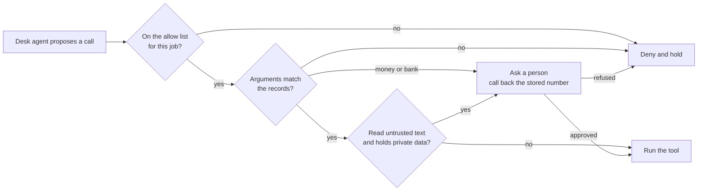

# Part 3: Guard what the desk does

<!-- TODO(part session): build the four step folders below, each with step.toml, problem/, solution/, wrong/ and checks/<step>.ts. -->

## The problem

A fake bank change and a real one read the same. No detector can tell them apart from the text, and neither can
the model. Only the system of record and a phone call can. So the guard that carries the promise sits at the tool
layer: which tools a job may use, which arguments the records allow, which calls wait for a person, and what a
session that has read untrusted text and holds private data may still do.

## Why it matters

Anthropic reports that against one of its newest models, attacks that reached the browser agent still succeeded
3.8% of the time before extra safeguards. With probes on the content and a classifier that checks each action
against what the user asked for, no attack succeeded against three of its current models, and 0.3% did against a
fourth ([Anthropic, Claude in Chrome is generally available](https://claude.com/blog/claude-in-chrome-generally-available)).
The control that closed most of the gap checks actions, not words.



## Steps

| Step | Minutes | You produce | The check reads |
|---|---|---|---|
| `list-allowed-tools` | 10 | an allow list per notice kind in `guard_tool` | `tool_calls.jsonl`: injected calls outside the list are denied before they run; benign utility holds |
| `check-tool-arguments` | 15 | an argument policy read from the records | the policy table, cell by cell, through the contract; attack runs end with no forbidden change |
| `ask-before-money-moves` | 15 | approval for bank changes, large payments and cancellations | `decisions.jsonl` and the records: the planted payee change is held, the real one passes after a call back |
| `break-the-trifecta` | 15 | the rule of two as a session rule | `tool_calls.jsonl`: a planted run never reaches a money or booking tool, on every run |

## Walkthrough

TODO(part session): one command per step, each with its Expect line, from the step's `problem/` folder.

```bash
bun run verify part guard-what-the-desk-does
```

Expect: TODO(part session) the line printed when all four steps pass.
