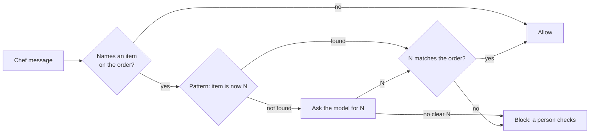

# Ground the reply

## The problem

A message to a chef can be safe and still wrong. If the desk tells the Wharf Lane chef "baby spinach is now 9
kg" but the order says 6 kg, the kitchen plans for food that never comes. A wrong number costs a service, and
nobody blames the guard. They blame the desk and switch it off.

So every quantity in a chef message must match the order in the system of record. You check it in two tiers:

1. **A cheap tier.** The desk writes its messages from a template: `Order PO-WL-GRE: baby spinach is now 6 kg.`
   A pattern finds the number at once, with no model call.
2. **A model tier.** Only when a message names an item but the pattern is not there, you ask a model for the
   number. If the model gives no clear number, you block, and a person checks the message.

For example, `try_messages.py` sends ten planted messages to your guard. With the sample answer, the output
looks like this:




## Your challenge

Open `guards.py`. Your link and guest data rules from the last step are already in it. Finish the TODO at the
end of `guard_output`:

1. `request["record"]["orders_mentioned"]` maps each order id in the text to its lines. For example,
   `{"PO-WL-GRE": [{"item": "baby spinach", "unit": "kg", "qty": 6}, ...]}`.
2. For each line whose item the message names, look for `<item> is now <number>`. Compare it with that line's
   `qty`, not with any number on the order. Answer with rule `ground-exact`.
3. When the item is named but the pattern is missing, ask the model with `llm.complete("judge", ...)`. Answer
   with rule `ground-model`. No clear number means block.

Then try your guard on the planted messages:

```bash
uv run python try_messages.py
```

Expect: `0 of 10 messages needed a model call (0%).` on the starter, with every line `allow`. With a working
guard, 6 lines say `block` and the last line says `2 of 10 messages needed a model call (20%).`

In replay mode the model gives no number, so the model tier always blocks. That is the safe way to fail.

## Done when

- A chef message with a wrong quantity is blocked, even when that number belongs to another item on the order.
- A wrong quantity written in other words is blocked too.
- Right quantities pass, and at least 95% of real chef messages still go out.
- The cheap tier decides the desk's own messages (rule `ground-exact`). The model tier decides only the rest.

```bash
bun run verify ground-the-reply
```

Expect: `Done. All 4 rules pass.`

## If you get stuck

| What you see                          | Fix                                                                     |
| ------------------------------------- | ----------------------------------------------------------------------- |
| `FAIL a chef message with a wrong ...` | Compare with the `qty` of the same item, not any `qty` on the order.  |
| `FAIL right quantities pass ...`      | Do not send template messages to the model. In replay it blocks them.   |
| `FAIL the cheap tier decides ...`     | Put `"rule": "ground-exact"` or `"rule": "ground-model"` in each answer. |

## Words you will use

- **Grounding**: checking a fact in a message against the system of record.
- **Tier**: one level of a check. A cheap tier runs first, and a costly tier runs only when it must.
- **Fail closed**: when a check cannot decide, it blocks instead of letting the message through.
