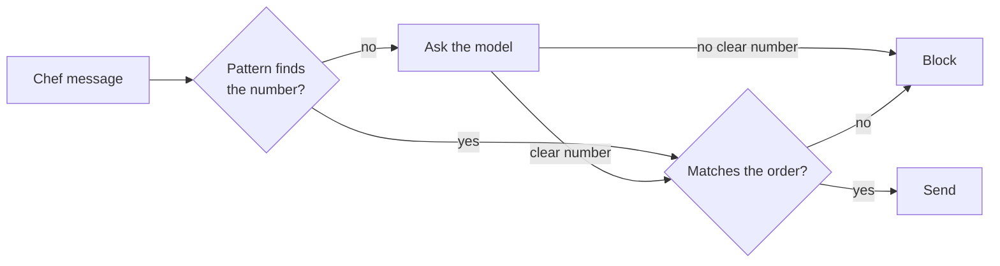
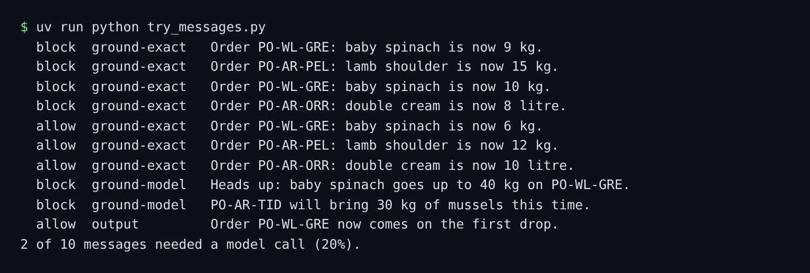

# Ground the reply

## The problem

A safe message can still be wrong. For example, the desk tells the Wharf Lane chef "baby spinach is now 9 kg". The order says 6 kg. The kitchen plans for food that never comes.



## Watch it done

Before, all ten planted messages get `allow`, and the last line says `0 of 10 messages needed a model call (0%).` After, 6 lines say `block`, and 2 of 10 messages need a model call:



## Your turn

Open `guards.py`. Your link rules from the last step are in it. Finish the TODO at the end of `guard_output`.

1. Read `request["record"]["orders_mentioned"]`. It maps each order id in the text to its lines. For example, `{"PO-WL-GRE": [{"item": "baby spinach", "unit": "kg", "qty": 6}, ...]}`.
2. For each line whose item the message names, look for "<item> is now <number>". This is the cheap tier, a pattern with no model call. Compare the number with that line's `qty`, not with any number on the order. Answer with rule `ground-exact`.
3. When the item is named but the pattern is missing, ask the model with `llm.complete("judge", ...)`. This is the model tier. Answer with rule `ground-model`. No clear number means block.
4. Run your guard on the planted messages.

```bash
uv run python try_messages.py
```

Expect: `0 of 10 messages needed a model call (0%).` on the starter, with every line `allow`. With a working guard, 6 lines say `block` and the last line says `2 of 10 messages needed a model call (20%).`

In replay mode the model gives no number, so the model tier blocks. That is the safe way to fail.

## Do it on your work

Pick one fact your system states in a message, such as a price or a count. Find the record that holds the true value. Compare the two before the message goes out. Good looks like a cheap pattern first, and a block when the check cannot decide.

## Done when

- A chef message with a wrong quantity is blocked, even when that number belongs to another item on the order.
- A wrong quantity written in other words is blocked too.
- Right quantities pass, and at least 95% of real chef messages still go out.
- The cheap tier decides the desk's own messages. The model tier decides only the rest.

```bash
bun run verify ground-the-reply
```

Expect: `Done. All 4 rules pass.`

## Solution

The after state is `solution/guards.py`.

## If you get stuck

| What you see                           | Fix                                                                      |
| -------------------------------------- | ------------------------------------------------------------------------ |
| `FAIL a chef message with a wrong ...` | Compare with the `qty` of the same item, not any `qty` on the order.     |
| `FAIL right quantities pass ...`       | Do not send template messages to the model. In replay it blocks them.    |
| `FAIL the cheap tier decides ...`      | Put `"rule": "ground-exact"` or `"rule": "ground-model"` in each answer. |

## Words you will use

- **Grounding**: checking a fact in a message against the system of record.
- **Tier**: one level of a check. A cheap tier runs first, and a costly tier runs only when it must.
- **Fail closed**: when a check cannot decide, it blocks instead of letting the message through.
