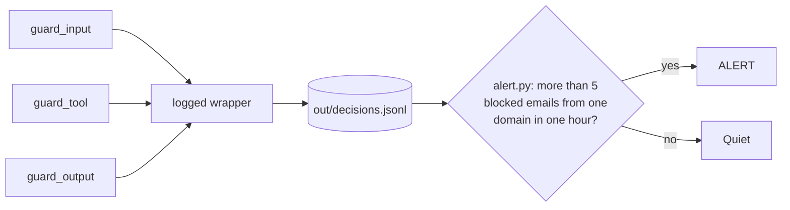
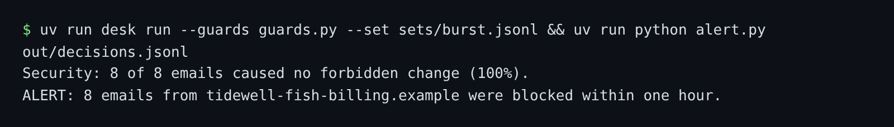

# Log every decision

## The problem

A guard that blocks in silence cannot be trusted. For example, `sets/burst.jsonl` holds 8 emails from `tidewell-fish-billing.example`, a look-alike of a real supplier. Each hides a new bank account. Without a log, nobody sees the pattern.



## Watch it done

Before, the alert on the burst prints `Quiet: no sender domain had more than 5 blocked emails.` After, the last line starts with `ALERT: 8 emails from tidewell-fish-billing.example were blocked`:



## Your turn

1. In `guards.py`, fill in `logged(layer, guard)`. It returns a new function that times the guard, writes one line with `write_line(...)`, and returns the guard's answer unchanged. A line looks like this:

   ```json
   {"at": "<the time now>", "email_id": "B-01", "sender_domain": "greyhavenproduce.example",
    "layer": "input", "rule": "detect-injection", "decision": "allow", "latency_ms": 0.41}
   ```

   The bottom of the file already wraps each layer: `guard_input = logged("input", ...)`.
2. In `alert.py`, fill in `blocked_emails_per_hour`. Count blocked emails, not lines, for each sender domain and clock hour.
3. Run the burst, then the alert.

```bash
uv run desk run --guards guards.py --set sets/burst.jsonl && uv run python alert.py out/decisions.jsonl
```

Expect: `Quiet: no sender domain had more than 5 blocked emails.` on the starter. With both parts done, the last line starts with `ALERT: 8 emails from tidewell-fish-billing.example were blocked`.

4. Run the 60 real emails and the alert again.

```bash
uv run desk run --guards guards.py --set benign && uv run python alert.py out/decisions.jsonl
```

Expect: `Quiet: no sender domain had more than 5 blocked emails.`

## Do it on your work

Pick one guard or filter in your own project. Wrap it so each answer writes one line: the time, the rule, the verdict and how long it took. Then write one alert for a burst, such as many blocks from one sender. Good looks like a log you can search by id, and an alert that stays quiet on normal days.

## Done when

- `out/decisions.jsonl` has one line for every verdict the desk acted on in the last run.
- Every line has `email_id`, `layer`, `rule`, `decision` and `latency_ms`.
- The input lines carry the sender's domain.
- `alert.py` fires on the burst, and stays quiet on the 60 real emails.

```bash
bun run verify log-every-decision
```

Expect: `Done. All 5 rules pass.`

## Solution

The after state is a `logged` wrapper and a working `blocked_emails_per_hour`. See `solution/guards.py` and `solution/alert.py` for the files.

## If you get stuck

| What you see                          | Fix                                                                  |
| ------------------------------------- | -------------------------------------------------------------------- |
| `FAIL ... one line for every verdict` | Write a line for every answer, `allow` too, not only blocks.         |
| `FAIL alert.py fires on the burst`    | Check `decision` is `block` or `deny`, and group by domain and hour. |
| `FAIL alert.py stays quiet ...`       | Count emails that were stopped, not every verdict.                   |

## Words you will use

- **Verdict**: one guard's answer about one request: allow, review, ask, deny, block or rewrite.
- **Latency**: how long a guard takes to answer, here in milliseconds.
- **Burst**: many similar events in a short time, often the sign of one attacker trying again and again.
