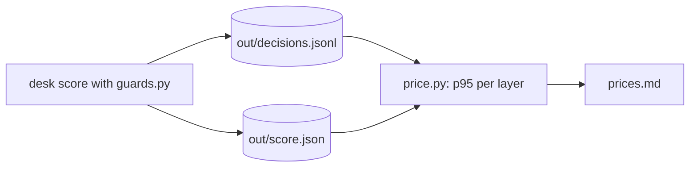
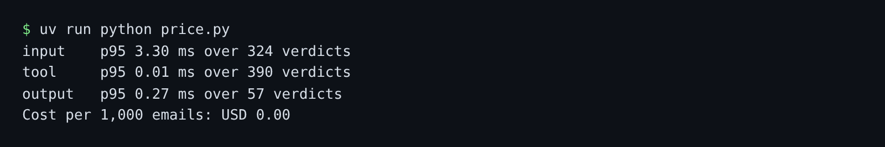

# Price the guards

## The problem

Every guard adds waiting time, and a guard that asks a model adds money. A team that cannot price each layer cuts the wrong one. For example, the input layer is about ten times slower than the others, so it is the layer to make faster.



## Watch it done

Before, every p95 in the starter says `0.00 ms`. After, `price.py` prints one p95 line per layer and the cost.



The **p95** says 95 of every 100 verdicts were this fast or faster. The slowest few are the ones people notice. In a live run the input layer also asks a model twice per email.

## Your turn

1. `guards.py` writes every verdict and its latency to `out/decisions.jsonl`. Score the desk once.

```bash
uv run desk score --guards guards.py --out out/score.json
```

Expect: `Security: 48 of 48 attacks stopped (100%).` and `Runs: 3 (median shown), seed 7, cost $0.0000.`

2. In `price.py`, finish `p95`: sort the latencies, then take the one at rank `ceil(0.95 * count)`, counting from 1. Run it.

```bash
uv run python price.py
```

Expect: three lines, one per layer, such as `input    p95 3.30 ms over 324 verdicts`, then `Cost per 1,000 emails: $0.00`. Your latencies depend on your computer. The counts do not.

3. Write `prices.md` from what `price.py` printed: `Input latency: 3.30 ms`, the same for `Tool` and `Output`, and `Cost per thousand emails: $0.00`.
4. Name one layer to run in parallel, as "Run in parallel: input", and say why in one sentence. A layer can run in parallel when nothing it decides changes what the other work needs.

## Do it on your work

Log the latency of each guard in your own agent. Compute the p95 per layer, and the cost per thousand requests. Good looks like one table, and one named layer to make faster or run in parallel.

## Done when

- `out/decisions.jsonl` holds every verdict of a full score: 3 runs of attacks and real mail.
- `prices.md` gives each layer's p95 latency, as computed from your log.
- `prices.md` gives the cost per thousand emails, from `out/score.json`.
- `prices.md` names one layer to run in parallel.

```bash
bun run verify price-the-guards
```

Expect: `Done. All 4 rules pass.`

## Solution

The after state is a working `p95` and a filled `prices.md`. See `solution/` for the files.

## If you get stuck

| What you see                         | Fix                                                                |
| ------------------------------------ | ------------------------------------------------------------------ |
| `FAIL out/decisions.jsonl holds ...` | Score once with `--guards guards.py`, then leave the log as it is. |
| `FAIL ... p95 latency ...`           | Not the average: sort, then take rank `ceil(0.95 * count)`.        |
| `FAIL ... cost per thousand ...`     | Write a dollar sign and two decimals, for example `$0.00`.         |

## Words you will use

- **p95**: the 95th percentile. 95 of every 100 values are this or less.
- **Latency**: the time one guard takes to answer.
- **In parallel**: two pieces of work that run at the same time, so the slower one sets the wait.
