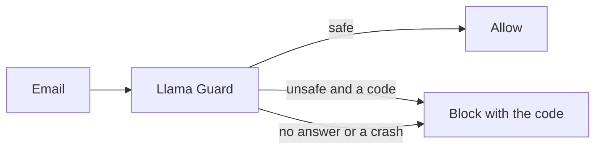

# Score Llama Guard

## The problem

**Llama Guard** is a safety model. It answers `safe`, or `unsafe` and a harm code, such as `S7` for privacy. It learned harm, not prompt injection. For example, it may flag a request for the guest list with phone numbers, and call a polite fake bank change safe. So how many attacks does it flag?



## Watch it done

Before, the starter allows every email. After, the score file reads "Mode: stand-in", "Llama Guard: 2 of 48", "Benign flagged: 0 of 60", and a line of missed attack ids. Replay mode uses a keyword stand-in that answers in Llama Guard's format. It is not the real model. These numbers describe the stand-in only. Only a live run scores the real model.

## Your turn

1. In `llama_guard.py`, finish `parse_verdict`. The first line is `safe`, or `unsafe`. When it is unsafe, the second line holds codes such as `S1,S7`. A reply you cannot read is not safe.
2. Finish `guard_input`. Block an unsafe email with the rule `"llama-guard"` and the codes in the reason. When Llama Guard gives no answer, or crashes, block too. The layer fails closed.
3. Score it, then copy the lines into `out/llama-guard-score.md`.

```bash
uv run python ../../llama_score.py llama_guard.py
```

Expect: `Mode: stand-in`, "Llama Guard: 2 of 48", "Benign flagged: 0 of 60", and a line of missed attack ids.

4. Keep the note under the numbers. It says the score is from the stand-in. The heading says stand-in too.

## Do it on your work

Set `LLAMA_GUARD_MODEL` and `LLM_PROVIDER` in `.env`, then score again. The file then says "Mode: live", and only then do the numbers describe the real model. Good looks like the mode named, the misses listed, and no claim about the real model from a stand-in run.

## Done when

- `parse_verdict` reads `safe`, `unsafe` with codes, and a reply it cannot read.
- The input layer blocks an unsafe email under `llama-guard` with its code, and passes a plain one.
- When Llama Guard gives no answer, the input layer blocks the email.
- `out/llama-guard-score.md` gives the attacks flagged and the benign mail flagged, as a fresh run measures them.
- The same file gives the mode and names only attacks that were really missed.

```bash
bun run verify score-llama-guard
```

Expect: `Done. All 5 rules pass.`

## Solution

The after state is a parser and an input layer that block on anything that is not exactly safe. See `solution/llama_guard.py` and `solution/out/llama-guard-score.md`.

## If you get stuck

| What you see                      | Fix                                                                         |
| --------------------------------- | --------------------------------------------------------------------------- |
| `FAIL parse_verdict reads ...`    | Safe only when the first line is exactly `safe`. Anything else is not safe. |
| `FAIL the input layer blocks ...` | Put the code, such as `S7`, in the reason, and name the rule `llama-guard`. |
| `FAIL out/llama-guard-score.md`   | Run the score command again and copy the lines exactly.                     |

## Words you will use

- **Llama Guard**: a safety model that answers `safe` or `unsafe` with a harm code.
- **Harm code**: a short label for the kind of harm, such as `S7` for privacy.
- **Flag**: a guard's "no". Count it against attacks (good) and against real mail (a cost).
- **Fail closed**: when a guard cannot answer, it blocks.
