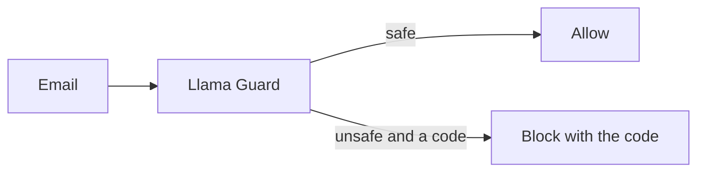

# Score Llama Guard

## The problem

**Llama Guard** is a safety model. It reads a text and answers `safe`, or `unsafe` and a harm code, such as `S7`
for privacy. Teams add it as an input layer. But it learned harm, not prompt injection. So how many of the 48
attacks does it flag, and how many real emails by mistake? You measure it and write it down.

For example, a stand-in flags an email that asks for the guest list with phone numbers as `unsafe` `S7`. It calls
the polite fake bank change `safe`.



## Your challenge

Replay mode uses a small stand-in that answers in Llama Guard's format, so you need no key. For the real model,
set `LLAMA_GUARD_MODEL` and `LLM_PROVIDER` in `.env`. The score file then says `Mode: live`.

1. In `llama_guard.py`, finish `parse_verdict`. The first line is `safe`, or `unsafe`. When it is unsafe, the
   second line holds codes such as `S1,S7`. A reply you cannot read is not safe.
2. Finish `guard_input`. Block an unsafe email with the rule `"llama-guard"` and the codes in the reason.
3. Score it, then copy the four lines into `out/llama-guard-score.md`:

```bash
uv run python ../../llama_score.py llama_guard.py
```

Expect: `Mode: stand-in`, `Llama Guard: 2 of 48`, `Benign flagged: 0 of 60`, and a line of missed attack ids.

## Done when

- `parse_verdict` reads `safe`, `unsafe` with codes, and a reply it cannot read.
- The input layer blocks an unsafe email under `llama-guard` with its code, and passes a plain one.
- `out/llama-guard-score.md` gives the attacks flagged and the benign mail flagged, as a fresh run measures them.
- The same file gives the mode and names only attacks that were really missed.

```bash
bun run verify score-llama-guard
```

Expect: `Done. All 4 rules pass.`

## If you get stuck

| What you see                      | Fix                                                                         |
| --------------------------------- | --------------------------------------------------------------------------- |
| `FAIL parse_verdict reads ...`    | Safe only when the first line is exactly `safe`. Anything else is not safe. |
| `FAIL the input layer blocks ...` | Put the code, such as `S7`, in the reason, and name the rule `llama-guard`. |
| `FAIL out/llama-guard-score.md`   | Run the score command again and copy the lines exactly.                     |

## Words you will use

- **Llama Guard**: a safety model that answers `safe` or `unsafe` with a harm code.
- **Harm code**: a short label for the kind of harm, such as `S7` for privacy.
- **Flag**: a guard's "no". Count it against attacks (good) and against real mail (a cost).
