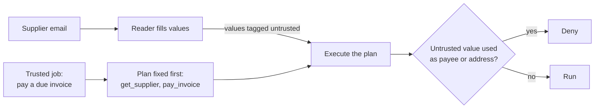

# Part 5: Go further

<!-- TODO(part session): build the step folders below, each with step.toml, problem/, solution/, wrong/ and checks/<step>.ts. -->

## The problem

Every guard so far reads text and makes a judgement, and a patient attacker adapts to judgements. The strongest
promise comes from the shape of the data flow: fix the plan from the trusted job before any email is read, and
never let a value that came from the email become a payee or an address. This optional part also swaps in a
guard framework, generates new attacks, runs a public benchmark, shadows a new guard before switching it on,
prices each layer, and attacks a peer's desk.

## Why it matters

Anthropic, reporting its own progress on browser agents, wrote that a 1% attack success rate, while a
significant improvement, still represents meaningful risk
([Anthropic, Mitigating the risk of prompt injections in browser use](https://www.anthropic.com/research/prompt-injection-defenses)).
Detection lowers the rate. Data flow is how you make a promise about the payee field that does not depend on it.



## Steps

| Step | Minutes | You produce | The check reads |
|---|---|---|---|
| `fix-the-plan-first` | 20 | a desk that writes its tool plan from the trusted job before any email is read | the run log: the plan is logged before the first email read, and no call outside the plan runs |
| `block-untrusted-payees` | 20 | taint tags on email values, and a policy that denies a tagged payee or address | security at 100% on all attack sets with the input detector off; the utility cost printed |
| `swap-in-a-guard-framework` | 30 | one layer rebuilt in a guard framework behind the same contract | the contract checks pass, and a score diff against your own guard |
| `generate-attacks-with-promptfoo` | 25 | new attacks from promptfoo pointed at the contract, added to your set | at least 20 new rows, a fresh score, and any new failure filed in the guard report |
| `run-the-agentdojo-banking-suite` | 30 | your input and tool guards as an AgentDojo defence | utility and security on the banking suite, printed beside the published defences |
| `shadow-a-new-guard` | 20 | a guard in shadow mode, then switched on by config | would-block counts in the log with no change to the records |
| `price-the-guards` | 15 | p95 latency and cost per 1,000 emails per layer | the numbers come from `decisions.jsonl`; one layer named to run in parallel |
| `attack-another-desk` | 20 | flags captured on a peer's desk (or the reference desk) | each flag is a forbidden change in the records, filed with its attack text |

## Walkthrough

TODO(part session): one command per step, each with its Expect line, from the step's `problem/` folder.

```bash
bun run verify part go-further
```

Expect: TODO(part session) the line printed when every step passes.
