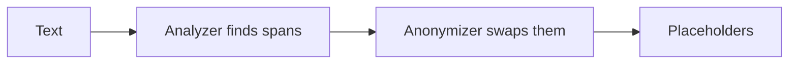

# Redact with Presidio

## The problem

A guest record holds a phone number and an email. For example, booking `PD-01` has both. If the text reaches a model as it is, private data leaves the building. Presidio is a free tool that finds private values and swaps them out. It does not know `PD-01`, so you teach it.



## Watch it done

Before, the starter prints the line as it came in.

```text
Booking PD-01 at WL, party of 10. Call +44 7700 900100 or write to harriet.vane@example.com.
```

After, your solution prints this line. The rest of the text is unchanged.

```text
Booking <BOOKING_REF> at WL, party of 10. Call <PHONE_NUMBER> or write to <EMAIL_ADDRESS>.
```

## Your turn

The task, the fixtures and the rubric are in `assignment/README.md`. You work in `assignment/redact.py`.

1. Run the starter and see the private values.

```bash
uv run --with presidio-analyzer==2.2.366 --with presidio-anonymizer==2.2.366 assignment/redact.py
```

Expect: three lines with the phone number and email still in them.

2. Build an analyzer from the email recogniser, the phone recogniser and one you write for `PD-` and two digits. Name the new kind `BOOKING_REF`. Keep it in the module variable `analyzer`, because the check looks there.
3. Write `redact(text)`. It runs the analyzer, then the anonymizer, and returns the new text.
4. Use a language engine with no model. Then nothing big downloads.
5. Run the fixture script.

```bash
uv run --with presidio-analyzer==2.2.366 --with presidio-anonymizer==2.2.366 assignment/check.py
```

Expect: "Done. All 3 lines pass." and a file `assignment/result.json`.

## Do it on your work

Pick one text file of your own that holds an email or a phone number. Run your `redact` on it and read the output. Good looks like no email or phone number left. If a value of your own, such as an order code, slips through, add one recogniser for it.

## Done when

- The Presidio packages resolve to the pinned version.
- Every fixture comes back with zero emails or phone numbers.
- The booking reference recogniser is registered and fires.

```bash
bun run verify redact-with-presidio
```

Expect: `Done. All 3 rules pass.`

## Solution

The after state is a `redact.py` that returns placeholders. See `solution/redact.py`.

## If you get stuck

| What you see                    | Fix                                                                  |
| ------------------------------- | -------------------------------------------------------------------- |
| `FAIL the Presidio packages`    | Run with `--with presidio-analyzer==2.2.366` and the anonymizer too. |
| `FAIL every fixture comes back` | Check that `redact` returns the anonymized text, not the original.   |
| `FAIL the booking reference`    | Register the recogniser on the same registry your analyzer uses.     |
| A 400 MB download starts        | You used the default engine. Pass your own language engine instead.  |

## Words you will use

- **Analyzer**: the Presidio part that finds private values and says what kind each one is.
- **Anonymizer**: the Presidio part that swaps each found value for a placeholder.
- **Recogniser**: one rule inside the analyzer, such as the email rule. You write one for bookings.
- **Placeholder**: a stand-in such as `<PHONE_NUMBER>` that keeps the shape of the text without the value.
