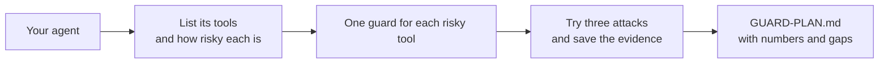

# Guard your own agent

## The problem

The desk guards worked because you could see every tool and every attack. Your own agent is different. Nobody
has listed its tools, tried an attack on it or written down what still gets through. For example, a library
assistant that can waive fines and email members needs the same guards as the desk. Until someone files the
attacks, nobody knows if it has them.



## Your challenge

Pick an agent you own or work with: a chatbot, a script that calls tools, a workflow with a model in it. It must
read text from outside, such as email, tickets or web pages. Work in this folder. The sample answer is about a
library assistant, so you can see the shape.

1. Open `GUARD-PLAN.md`. Fill in the title, `Agent`, `Owner` and `Untrusted input` for your agent.
2. List every tool it can use in the Tools table. Mark its effect and the layer where you guard it. Anything
   that moves money or sends outside must be `ask` or `deny`.
3. Try three different attacks on your agent. Save each one in `evidence/attack-1.txt`, `attack-2.txt` and so on.
   A file holds the attack text and a line that starts `Result:` with what your agent did.
4. File the attacks in the plan, then fill in the Numbers and Known gaps.
5. Check your work:

```bash
bun run verify guard-your-own-agent
```

Expect: `Done. All 7 rules pass.` on the sample, and a `FAIL` line for each part still to fill in on the starter.

## Do it on your work

Run the same plan on the agent you ship. Good looks like three real attacks with evidence, one gap you could
not close, and a number for the real tasks that still work.

## Done when

- The plan names your agent, its owner and where untrusted text enters. It is not about the desk.
- The Tools table has at least four tools, each with an effect, a layer, a rule and a decision.
- A tool that moves money or sends outside is `ask` or `deny`, and private data is hidden.
- At least three different attacks are filed, each with the layer that stopped it.
- Each attack has an evidence file with the attack text and a `Result:` line.
- The numbers match the table, and most real tasks still get done.
- Known gaps names at least one thing the guards do not stop.

## If you get stuck

| What you see                 | Fix                                                                  |
| ---------------------------- | -------------------------------------------------------------------- |
| `FAIL ... an evidence file`  | The file must be in `evidence/`, hold the attack text and `Result:`. |
| `FAIL the numbers match`     | `Attacks tried` must equal the rows you filed.                       |
| `FAIL ... never plain allow` | Set the money or outside tool to `ask` or `deny`.                    |

## Words you will use

- **Evidence**: a saved record of one attack and what your agent did.
- **Layer**: where a guard sits: `input`, `tool`, `output` or `result`.
- **Known gap**: an attack your guards still miss. Naming it is part of the plan.
