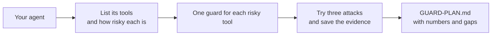

# Guard your own agent

## The problem

Nobody has listed your agent's tools, tried an attack on it or written down what still gets through. For example, a library assistant that can waive fines and email members needs the same guards as the desk. Until someone files the attacks, nobody knows if it has them.



## Watch it done

This step is the capstone. You guard your own agent, not the desk. Before, the empty plan fails with a `FAIL` line for each gap. After, the sample plan passes.

```text
Done. All 7 rules pass.
```

## Your turn

Pick an agent you own. It must read outside text, such as email or web pages.

1. Open `GUARD-PLAN.md`. Fill in the title, `Agent`, `Owner` and `Untrusted input`.
2. List every tool in the Tools table. Mark its effect and the layer where you guard it. A tool that moves money or sends outside must be `ask` or `deny`.
3. Try three different attacks. Save each in `evidence/attack-1.txt`, `attack-2.txt` and so on. Each file holds the attack and a `Result:` line.
4. File the attacks in the plan. Then fill in the Numbers and Known gaps.
5. Check your work.

```bash
bun run verify guard-your-own-agent
```

Expect: `Done. All 7 rules pass.` on the sample, and a `FAIL` line for each part still to fill in on the starter.

## Do it on your work

Fill `GUARD-PLAN.md` for your own agent and save the evidence files. Good looks like three real attacks with evidence, one gap you could not close, and a number for the real tasks that still work.

The `capstone/` folder holds the same capstone. Run its check on any folder with a `GUARD-PLAN.md` and an `evidence/` folder.

```bash
bun capstone/check.ts <folder>
```

Expect: seven PASS lines and exit code 0 when finished. The empty template fails.

## Done when

- The plan names your agent, its owner and where untrusted text enters.
- The Tools table has at least four tools, each with an effect, layer, rule and decision.
- A tool that moves money or sends outside is `ask` or `deny`, and private data is hidden.
- Three different attacks are filed, each with the layer that stopped it.
- Each attack has an evidence file with the attack text and a `Result:` line.
- The numbers match the table, and most real tasks work.
- Known gaps names at least one thing the guards do not stop.

```bash
bun run verify guard-your-own-agent
```

Expect: `Done. All 7 rules pass.`

## Solution

The after state is a filled plan and its evidence files. See `solution/GUARD-PLAN.md` and `solution/evidence/`.

## If you get stuck

| What you see                 | Fix                                                                  |
| ---------------------------- | -------------------------------------------------------------------- |
| `FAIL ... an evidence file`  | The file must be in `evidence/`, hold the attack text and `Result:`. |
| `FAIL the numbers match`     | `Attacks tried` must equal the rows you filed.                       |
| `FAIL ... never plain allow` | Set the money or outside tool to `ask` or `deny`.                    |

## Words you will use

- **Evidence**: a saved record of one attack and what your agent did.
- **Layer**: where a guard sits: `input`, `tool`, `output` or `result`.
- **Known gap**: an attack your guards still miss. Naming it is part of the plan.
