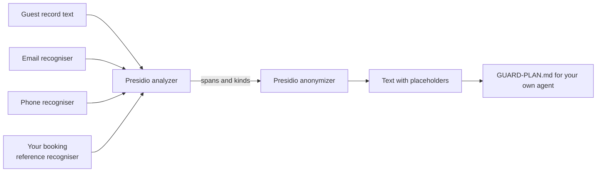

# Block private data with Presidio

## After this part you can

Hide private data with Presidio, then guard an agent of your own.

## You leave with

A `redact.py` that swaps emails and phone numbers for placeholders, and a `GUARD-PLAN.md` with evidence for your own agent.

## The problem

You built your own guest data redactor, and it works. A team that ships it still prefers a tool other teams trust. For example, booking `PD-01` has a phone number and an email. Presidio finds both and returns `<PHONE_NUMBER>` and `<EMAIL_ADDRESS>`. It does not know `PD-01`, so you add one recogniser. Then you take the same care to an agent you own.



## Steps

| Step                   | You produce                                                              | The check reads                                                               |
| ---------------------- | ------------------------------------------------------------------------ | ----------------------------------------------------------------------------- |
| `redact-with-presidio` | `assignment/redact.py`: Presidio swaps the guest values for placeholders | the package version, the guest fixtures, and the booking reference recogniser |
| `guard-your-own-agent` | `GUARD-PLAN.md` and an `evidence/` folder for an agent you own           | the plan's shape, the evidence files, and numbers that match the table        |

```bash
bun run verify redact-with-presidio
```

Expect: `Done. All 3 rules pass.` once your work is right.

## Watch and read

| Kind | Title                                       | Author    | Why                                                                        | Link                                                         |
| ---- | ------------------------------------------- | --------- | -------------------------------------------------------------------------- | ------------------------------------------------------------ |
| read | Building effective AI agents                | Anthropic | The team that runs agents in production shows simple designs that hold up. | https://www.anthropic.com/research/building-effective-agents |
| read | Mitigating prompt injections in browser use | Anthropic | Shows layered guards against hidden instructions in outside text.          | https://www.anthropic.com/research/prompt-injection-defenses |
| read | Making Claude Code safer with sandboxing    | Anthropic | Shows how to limit what an agent can touch, the same idea as a tool guard. | https://www.anthropic.com/research/claude-code-sandboxing    |

## Project

Guard one agent you own with the capstone. Fill `GUARD-PLAN.md`, save three attacks in `evidence/`, then run the check on your folder.

```bash
bun capstone/check.ts <folder>
```

Expect: seven PASS lines and exit code 0 when finished.
