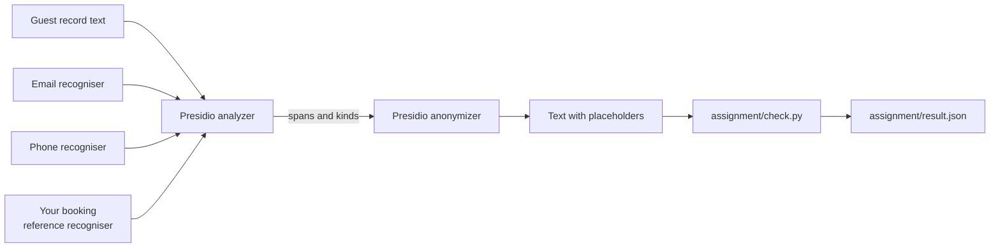

# Part 6: Do it with the tools teams run

## The problem

In part 2 you wrote your own guest data redactor. It works, and you know every line of it. But a team that
ships this does not keep a home-made redactor. It uses a tool other teams already trust, so the next engineer
meets code they know.

This part is optional in the live session and expected as homework. You redo one thing you built by hand with
the open source tool teams run: Presidio, a library that finds private data in text and swaps it out. Nothing
you built earlier changes.

For example, booking `PD-01` has a phone number and an email address. Presidio finds both and returns
`<PHONE_NUMBER>` and `<EMAIL_ADDRESS>` in their place. Presidio does not know what `PD-01` is, so you teach it.

## Why it matters

Presidio is the name most teams reach for when they need to find personal data in text. Its pattern
recognisers need no model download. They are fast and they give the same answer every time. You can read the
pattern that fired, which a reviewer likes.

The trade is that a pattern only finds what its author thought of. Your booking reference is the proof. The
built-in recognisers miss it, so you write one.



## What we teach

- Run an analyzer and an anonymizer, and read what each one returns.
- Add one custom recogniser for a value only your business has.
- Prove with a script that no email or phone number survives.

## Steps

| Step                   | Minutes | You produce                                                              | The check reads                                                               |
| ---------------------- | ------- | ------------------------------------------------------------------------ | ----------------------------------------------------------------------------- |
| `redact-with-presidio` | 20      | `assignment/redact.py`: Presidio swaps the guest values for placeholders | the package version, the guest fixtures, and the booking reference recogniser |

The assignment folder is `assignment/`. Its `README.md` holds the task, the Done when lines and the rubric.

## Options

Presidio is not the only way to do this job.

- **NeMo Guardrails PII rails.** Choose when the app already runs NeMo rails, as the desk does in part 5.
  Trade-off: one more config layer for one job.

Write your own choice in `assignment/CHOICE.md`, in a few sentences.

## Walkthrough

Every command below starts from the repo root. The first run needs the internet once, to fetch Presidio.

```bash
uv run --with presidio-analyzer==2.2.366 --with presidio-anonymizer==2.2.366 assignment/redact.py
```

Expect: three lines such as `Booking PD-01 at WL, party of 10. Call +44 7700 900100 or write to
harriet.vane@example.com.` on the starter. With your solution the same lines read `Booking <BOOKING_REF> at
WL, party of 10. Call <PHONE_NUMBER> or write to <EMAIL_ADDRESS>.` The rest of the text is unchanged.

```bash
uv run --with presidio-analyzer==2.2.366 --with presidio-anonymizer==2.2.366 assignment/check.py
```

Expect: `FAIL` on two of the three lines and `Not done yet.` on the starter, and `Done. All 3 lines pass.` with
your solution. The script writes `assignment/result.json`.

```bash
bun run verify redact-with-presidio
```

Expect: `Done. All 3 rules pass.` once your work is right.

## Finished

You redid a guard you built by hand with a tool other teams run. You kept the same fixtures green. You also
learned where the tool stops: it found emails and phone numbers for free, and it needed one recogniser from
you for the booking reference. Guest names need a language model, which this part leaves out.
